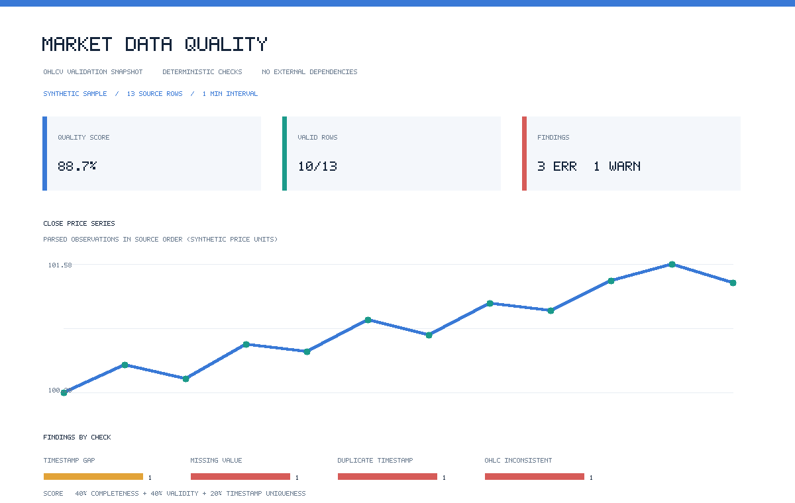
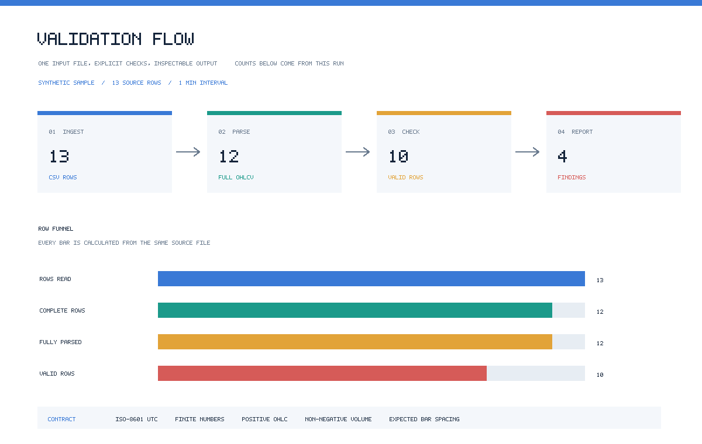

# Market Data Quality Framework

A dependency-free Python toolkit for validating time-series OHLCV market data,
summarising data-quality findings, and generating reproducible visual reports.
The sample and screenshots contain synthetic illustrative data only.

## Quickstart

Requires Python 3.10 or later. The package uses only the Python standard
library; install it locally or run directly from the source tree.

```bash
python -m pip install -e .
mdq data/sample_ohlcv.csv
mdq data/sample_ohlcv.csv --format json
mdq data/sample_ohlcv.csv --write-reports reports
python -m unittest discover -s tests -v
```

Direct source-tree invocation:

```bash
PYTHONPATH=src python -m mdq data/sample_ohlcv.csv --format json
```

`--strict` returns exit status 1 when the input contains validation errors.
Without it, a report is still emitted with status 0; unreadable inputs and
invalid command options return status 2.

## Report visuals

Overview charts show the parsed close series and observed validation findings.
The flow view shows record counts at each step. Both are derived from the same
CSV validation result and are emitted as editable SVG and white-background PNG
files. PNG encoding and drawing use only the standard library.





Regenerate them after changing the sample:

```bash
PYTHONPATH=src python -m mdq data/sample_ohlcv.csv --write-reports reports
```

## Checks and scoring

The validator checks required columns and values, ISO-8601 timestamps,
finite numeric values, positive OHLC prices, non-negative volume, OHLC
consistency, duplicate and out-of-order timestamps, and gaps relative to the
configured interval. Missing rows are not synthesized and exchange calendars
are not inferred.

The illustrative score is a weighted diagnostic:

```text
40% completeness + 40% row validity + 20% timestamp uniqueness
```

Warnings for timestamp gaps and source ordering are surfaced separately and
do not invalidate an otherwise complete row. See
[`docs/data-contract.md`](docs/data-contract.md) for definitions and
limitations. This score is not a quality certification.

## Python API

```python
from mdq import validate_csv

report = validate_csv("data/sample_ohlcv.csv", expected_interval_minutes=1)
print(report.quality_score)
print(report.to_dict())
```

The validator accepts a path or a text file-like object. `report.bars` contains
rows whose timestamp and all OHLCV numeric fields parsed; quality rules are
reported independently in `report.issues`.

An optional standard-library-only day calendar is available from
`mdq.calendars`. It is a reference utility, not an authoritative source and is
not used to suppress gap findings:

```python
from datetime import date
from mdq.calendars import calendar

states = calendar("NYSE", "2026-01-01", "2026-01-05")
print(states[date(2026, 1, 1)])  # "closed"
```
